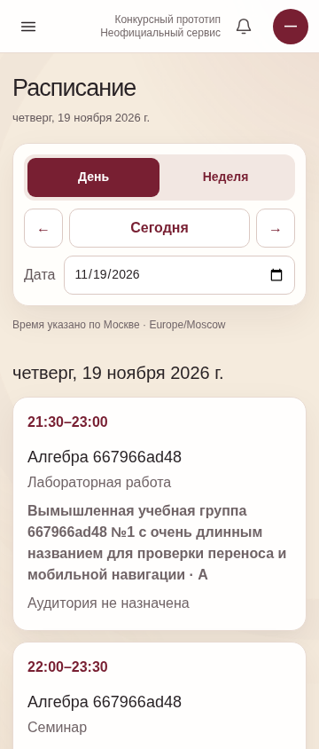
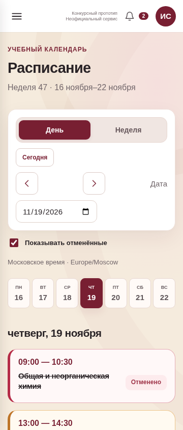
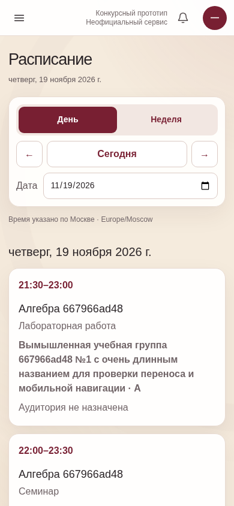
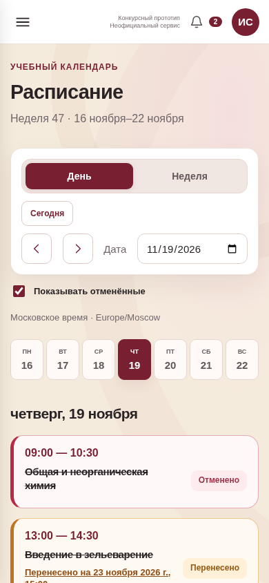
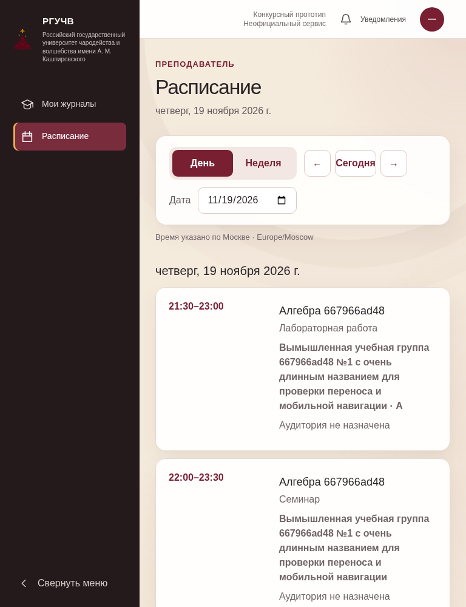
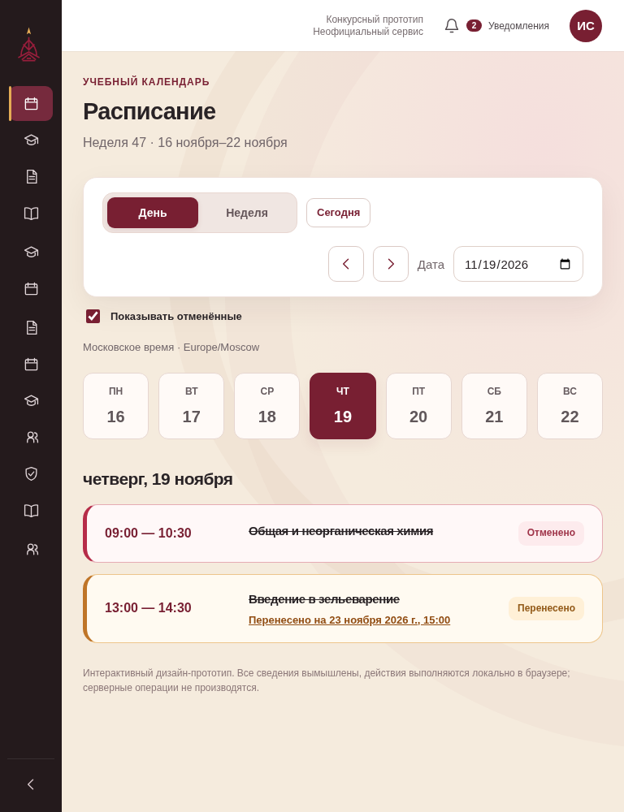
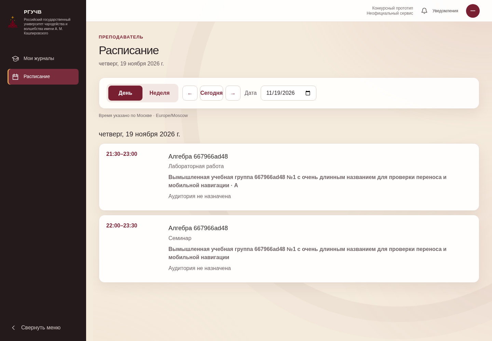
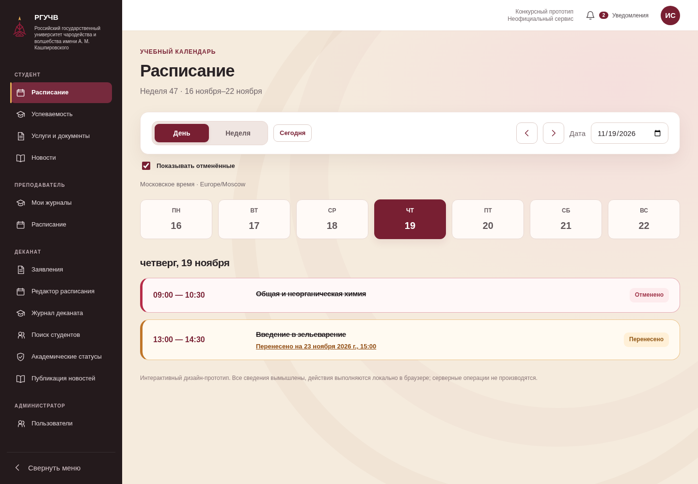
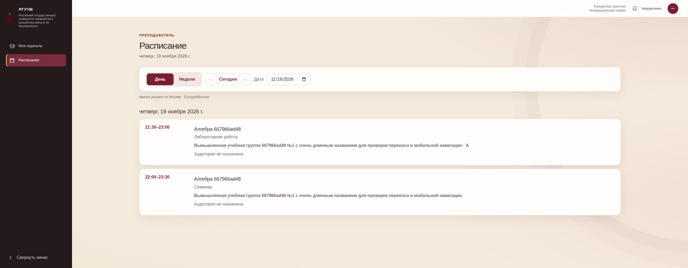
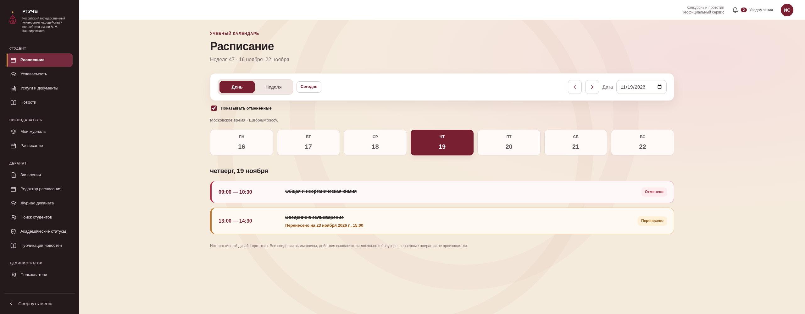

# MVP2 visual acceptance — issue #149

Browser captures made with Chromium against the real application, local API and isolated PostgreSQL test fixtures. The HTML files came from `docs/design/uni-space-mvp2-unified-v5.html` (merged PR #150). Reference fixtures are explicitly fictional and perform no server operations.

## Teacher schedule comparison

The teacher schedule retains the shared day/week interaction and its own lesson context. Real lesson data was loaded from the API. The HTML page shows the student schedule, so status examples and its cancelled-lesson toggle are not expected in the teacher view.

| Viewport | Application | HTML reference |
| --- | --- | --- |
| 360 px |  |  |
| 390 px |  |  |
| 768 px |  |  |
| 1440 px |  |  |
| 2560 px |  |  |

Further states:

- [Teacher week view, 1440 px](app-teacher-schedule-week-1440.png)
- [Teacher week view with reduced motion, 390 px](app-teacher-schedule-week-reduced-motion-390.png)
- [Teacher journals initial state, 1440 px](app-teacher-journals-1440.png)

## Findings and fixes

- The teacher schedule toolbar squeezed “Сегодня” into an arrow-sized button. The button now keeps its intrinsic width.
- On narrow screens the date label/input wrapped into a narrow extra column and overlapped. The mobile teacher toolbar now uses full-width segmented day/week controls, a three-column previous/today/next row, and a full-width date row.
- Teacher schedule heading size and lesson-card layout now follow the agreed schedule typography and time/details composition while keeping the teacher-specific lesson type, group, room, and time data.
- Browser capture initially caught loading and in-progress transitions. Captures now wait for API-backed lesson cards and transition completion. The final screenshots show stable loaded states.
- `prefers-reduced-motion: reduce` was exercised for the day/week switch. No transition was observed in the reduced-motion capture.

## Scope and limitations

Visual browser comparison was performed for the teacher schedule at 360, 390, 768, 1440 and 2560 px; day and week states; reduced motion; and the teacher journals initial state. Functional E2E coverage also exercised teacher and staff journal workflows, role scoping, revocation and ambiguous write recovery. The remaining student, staff and administrator MVP2 routes and their modal, error, empty, and populated states were not individually captured and visually compared in this run. The student schedule implementation and the approved MVP1 layout were not modified.

These artifacts document the observed browser states; they do not claim visual sign-off for routes not listed above.
